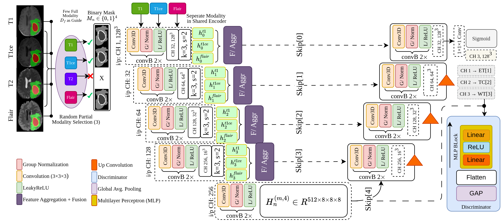
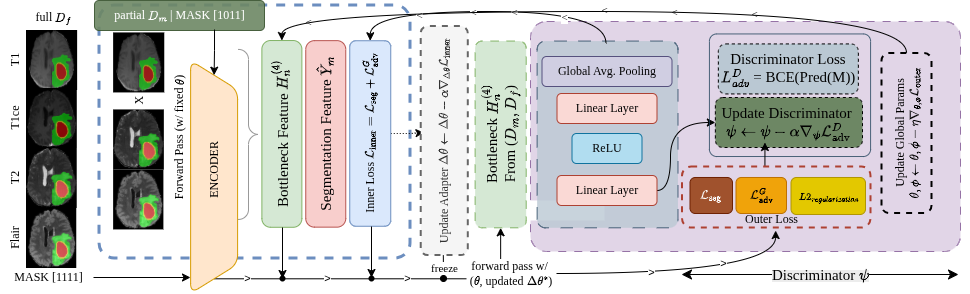

# Bi-Level Meta-Learning for Brain Tumor Segmentation with Missing MRI Modalities

This repository contains the source code for **METAL**, a segmentation framework designed for brain tumor segmentation when one or more MRI modalities are unavailable. The approach combines an nnUNet-inspired 3D backbone, attention-based feature fusion, lightweight adapters, and adversarial modality regularization within a bi-level meta-learning strategy. Methodology overview:



## Bi-Level Meta-Learning

The inner loop adapts lightweight parameters using partial-modality data, while the outer loop updates the global network and meta-generator using full-modality data. An adversarial modality discriminator is trained alongside the segmentation model to encourage modality-invariant bottleneck representations. See the overview below:



## Directories

```
├── src/
│   ├── models/
│   │   ├── encoders.py
│   │   ├── decoders.py
│   │   ├── generators.py
│   │   ├── discriminator.py
│   │   └── segmentation.py
│   ├── data/
│   │   ├── dataset.py
│   │   └── preprocessing.py
│   ├── training/
│   │   └── bilevel_trainer.py
│   └── config.py
├── scripts/
│   ├── train.py
│   └── evaluate.py
├── notebooks/
├── figs/
├── checkpoints/
├── requirements.txt
└── README.md
```

## Dataset

We evaluate METAL on public benchmark datasets from the Brain Tumor Segmentation (BraTS) challenge series:

> **BraTS2019**: [Multimodal Brain Tumor Image Segmentation Benchmark](https://www.med.upenn.edu/cbica/brats-2019/)

> **BraTS2020**: [Multimodal Brain Tumor Segmentation Challenge 2020](https://www.med.upenn.edu/cbica/brats2020/)

> **BraTS2021**: [RSNA-ASNR-MICCAI Brain Tumor Segmentation Challenge](https://www.med.upenn.edu/cbica/brats2021/)

Each case contains four co-registered MRI modalities: FLAIR, T1, T1ce, and T2, together with an expert segmentation mask. Missing modalities are simulated by randomly sampling partial modality combinations during training and evaluation.


## Requirements

The following Python packages are required to run the code:

- PyTorch >= 2.0.0
- torchvision >= 0.15.0
- MONAI >= 1.2.0
- NumPy >= 1.24.0
- nibabel >= 5.0.0
- SciPy >= 1.10.0
- scikit-learn >= 1.3.0
- Matplotlib >= 3.7.0
- tqdm >= 4.66.0


## Citation

Will be updated.
